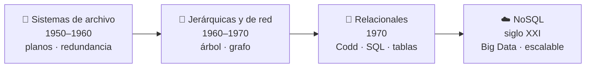
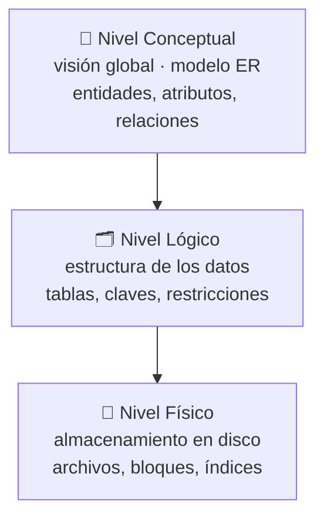
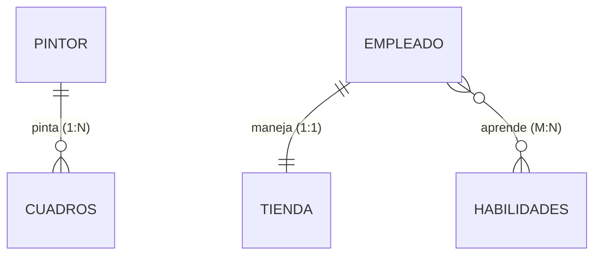
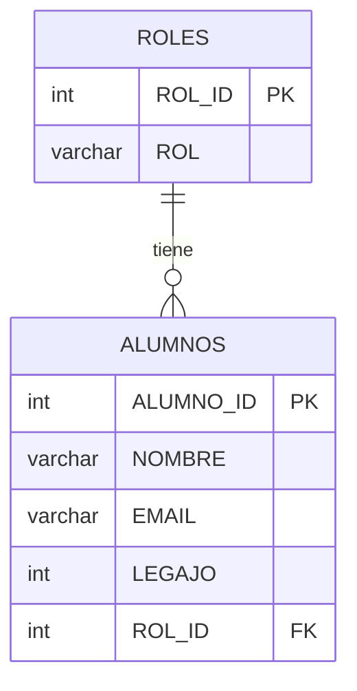
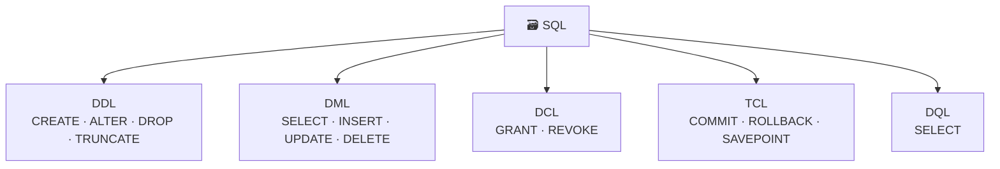

# Ingeniería de Datos I — Resumen de la materia

> Guía de estudio completa y autocontenida de la materia **Ingeniería de Datos I (UADE)**.
> Ordenada por unidades (UVA). Cada tema trae la teoría resumida y ejemplos de código.
> El documento está pensado para ir agregando UVAs a medida que se cursan.

---

## Índice

- [UVA 1 — Fundamentos de bases de datos](#uva-1--fundamentos-de-bases-de-datos)
- [UVA 2 — Modelos de BD y arquitectura del SGBD](#uva-2--modelos-de-bd-y-arquitectura-del-sgbd)
- [UVA 3 — El modelo relacional](#uva-3--el-modelo-relacional)
- [UVA 4 — Álgebra relacional](#uva-4--álgebra-relacional)
- [UVA 5 — SQL (lenguaje de consulta estructurado)](#uva-5--sql-lenguaje-de-consulta-estructurado)
- [Trabajo Práctico Integrador (TPO)](#trabajo-práctico-integrador-tpo)
- [Próximas UVAs (6 y 7)](#próximas-uvas-6-y-7)
- [Glosario rápido](#glosario-rápido)

---

## UVA 1 — Fundamentos de bases de datos

### 1. ¿Qué es una base de datos?

Una **base de datos (BD)** es un conjunto **estructurado y organizado** de datos relacionados que comparten un mismo contexto, almacenados de forma sistemática para facilitar su uso posterior. Su objetivo es permitir **almacenar, recuperar y administrar** información de forma eficiente (acceso frecuente, múltiples usuarios, integridad).

Los datos se organizan jerárquicamente:

| Nivel | Definición | Ejemplo |
|-------|-----------|---------|
| **Campo** | Unidad mínima de información | `Nombre` de una persona |
| **Registro** | Colección de campos que describe una entidad | Un alumno completo |
| **Archivo** | Colección de registros similares | Todos los alumnos |

### 2. Evolución: de sistemas de archivo a bases de datos

1. **Sistemas de archivo (1950-1960)**: archivos planos (flat files). Cada aplicación maneja sus propios archivos. Problemas:
   - **Redundancia**: mismo dato duplicado en varios archivos.
   - **Inconsistencia**: se actualiza en un archivo y no en otro.
   - **Dependencia de la aplicación**: si cambia la estructura, se reescribe el programa.
   - **Dificultad de acceso** a consultas complejas.
   - **Falta de integridad y seguridad**.

2. **Bases jerárquicas y de red (1960-1970)**: organización en árbol (jerárquica, un solo padre; ej. IMS de IBM) o en grafo (de red, múltiples padres). Mejoraron el acceso, pero seguían siendo rígidas y difíciles de programar.

3. **Bases relacionales (1970)**: propuestas por **Edgar F. Codd**. Datos en **tablas (relaciones)** con filas y columnas. Lenguaje estándar **SQL**, independencia de datos, integridad por claves. Ejemplos: Oracle, MySQL, SQL Server.

4. **Bases NoSQL (Siglo XXI)**: para Big Data y datos no estructurados. **Escalabilidad horizontal**, **flexibilidad de esquema**, rendimiento optimizado. Complementan (no reemplazan) a las relacionales.



### 3. Beneficios de una BD frente a archivos planos

- **Control centralizado** de los datos.
- **Reducción de la redundancia** (normalización).
- **Evitar la inconsistencia**.
- **Compartir datos** entre usuarios.
- **Control de acceso** y **seguridad**.
- **Integridad** (reglas de validación / restricciones).
- **Propagación de actualizaciones**.
- **Equilibrar requerimientos contradictorios** (seguridad vs. disponibilidad).

### 4. Sistemas de almacenamiento

Son la base física de las BD. Pueden ser **locales, en servidores dedicados o distribuidos**.

**Limitaciones de los archivos planos**: redundancia, dificultad de consultas complejas, ausencia de integridad referencial, sin acceso concurrente ni seguridad.

**Escalabilidad**:
- **Vertical**: más recursos (CPU, RAM) en un servidor. Tiene límite.
- **Horizontal**: más servidores (nodos).

Los SGBD manejan accesos simultáneos con **control de concurrencia** y **bloqueo de registros**.

### 5. Tipos de datos comunes

`INT` (entero), `FLOAT`/`DECIMAL` (decimales), `CHAR`/`VARCHAR` (texto), `DATE`/`DATETIME` (fechas), `BOOLEAN`/`BIT` (lógico). Elegir bien el tipo optimiza almacenamiento y valida valores.

### 6. Hashing

Técnica que transforma una **clave** en una **dirección** (valor hash de longitud fija) para acceder rápido a los datos, sin búsquedas secuenciales.

**Propiedades de una buena función hash**:
- **Determinista**: misma entrada → misma salida.
- **Distribuye uniformemente** (evita agrupamientos/colisiones).

**Tipos**:
- **Estáticas**: función fija.
- **Dinámicas**: se adaptan al crecimiento.
- **Perfectas**: sin colisiones (solo en contextos acotados).
- **Criptográficas** (MD5, SHA-256): costosas, para integridad/seguridad, no para estructuras de datos.

**Algoritmos más comunes**:

- **División**: $h(k) = k \bmod m$ (donde $m$ es el tamaño de la tabla).
- **Multiplicación**: usa una constante para dispersar las claves.
- **Plegamiento**: divide y suma bloques de la clave.

**Ejemplo paso a paso** (tabla de tamaño 7, claves: 10, 22, 31, 4, 15, 28, 17, 88, 59 con `h(k)=k mod 7`):

| Clave | 10 | 22 | 31 | 4 | 15 | 28 | 17 | 88 | 59 |
|-------|----|----|----|---|----|----|----|----|----|
| h(k)=k mod 7 | 3 | 1 | 3 | 4 | 1 | 0 | 3 | 4 | 3 |

→ Colisiones en posiciones 1, 3 y 4.

**Colisiones y resolución** (dos claves distintas → mismo hash):
- **Encadenamiento**: lista enlazada en la misma posición.
- **Direccionamiento abierto**: buscar otra posición libre (lineal, cuadrático o doble hashing).
- **Área de desborde**: zona separada para los que colisionan.

**Usos**: búsqueda exacta, `partitioning`/`sharding` en BD distribuidas, detección de duplicados, verificación de integridad (checksums), caché, autenticación.

### 7. Índices

Estructura auxiliar que localiza registros rápido **sin escanear toda la tabla** (como el índice de un libro). Contiene punteros a las ubicaciones físicas.

| Tipo | Descripción |
|------|-------------|
| **Primario** | Sobre la **clave primaria**; suele ordenar físicamente el archivo; único. |
| **Clustered (agrupado)** | Ordena **físicamente** las filas según el índice. **Solo uno por tabla**. Bueno para rangos (fechas). Penaliza INSERT/UPDATE/DELETE. |
| **Secundario** | Sobre campos no clave (nombre, fecha, categoría); no ordena físicamente; puede haber varios. |
| **No agrupado (non-clustered)** | Estructura separada (árbol B / hash) con clave + puntero. Consume más espacio y E/S. |
| **Multinivel** | Jerarquía de índices (base de los **árboles B+**); eficiente en tablas muy grandes. |
| **Compuesto / multicolumna** | Usa 2+ columnas (ej. nombre + apellido). |
| **Único** | No permite duplicados (DNI, email). |
| **Hash** | Acceso directo por transformación. Solo búsqueda **exacta** (no rangos). |

**Ventajas**: aceleran lecturas, joins y filtros.
**Costo**: demasiados índices ralentizan escrituras y aumentan tamaño.

**Árbol B+**: estructura balanceada; **todas las claves en las hojas** (enlazadas para recorridos secuenciales), nodos internos solo con claves de referencia. Base del indexado en SGBD.

---

## UVA 2 — Modelos de BD y arquitectura del SGBD

### 1. Modelos de bases de datos

| Modelo | Estructura | Características |
|--------|-----------|-----------------|
| **Jerárquico** | Árbol (padre/hijo, 1:M) | Eficiente en consultas jerárquicas, rígido. |
| **Red** | Grafo (múltiples padres) | Más flexible, difícil de gestionar. |
| **Relacional** | Tablas con claves | Estándar dominante, SQL, integridad. |
| **Orientado a objetos** | Objetos (encapsulación, herencia, polimorfismo) | Para datos complejos, adopción no masiva. |
| **NoSQL** | Documentos, clave-valor, columnas, grafos | Escalabilidad horizontal, esquema flexible. |

### 2. Bases NoSQL: clasificación

- **Clave-valor**: pares clave→valor (ej. **Redis**, **DynamoDB**). Caché, sesiones, colas.
- **Documentales**: documentos JSON/BSON (ej. **MongoDB**). Apps web, datos jerárquicos.
- **Columnares**: datos por columnas (ej. **Cassandra**, **HBase**). Analítica masiva.
- **Grafos**: nodos y aristas (ej. **Neo4j**). Redes sociales, recomendación, rutas.

**Comparación SQL vs NoSQL**:

| Característica | Relacional (SQL) | NoSQL |
|----------------|------------------|-------|
| Rendimiento | Bajo | Alto |
| Consistencia | Bueno (fuerte) | Bajo (eventual) |
| Escalabilidad | Alto (vertical, costoso) | Alto (horizontal) |
| Esquema | Fijo | Flexible |
| Transacciones | **ACID** | **BASE** (Basically Available, Soft-state, Eventual consistency) |

**Equivalencias de comandos** (MongoDB vs SQL):

```text
SQL:      INSERT INTO account (...) VALUES (...)
MongoDB:  db.account.insert({ ... })

SQL:      UPDATE account SET ... WHERE ...
MongoDB:  db.account.update({cond}, {$set: {...}})

SQL:      DELETE FROM account WHERE ...
MongoDB:  db.account.remove({cond})
```

**Criterios para elegir**: naturaleza de los datos, volumen, velocidad de crecimiento, necesidad de transacciones, arquitectura y tolerancia a fallos. SQL → sistemas financieros, ERP, salud. NoSQL → e-commerce, redes sociales, IoT, big data.

### 3. SGBD (Sistema de Gestión de Bases de Datos)

Software que interactúa con la BD, los usuarios y las aplicaciones.

**Objetivos**:
- Interfaz para crear/modificar la BD.
- Manejar almacenamiento y recuperación.
- Controlar acceso concurrente.
- Garantizar seguridad e integridad.

**Componentes**:
- **Motor de almacenamiento**: gestión física de datos.
- **Procesador de consultas**: analiza, valida sintaxis/semántica y ejecuta.
- **Optimizador de consultas**: elige el plan de ejecución de menor costo.
- **Manejo de transacciones**: propiedades ACID.
- **Subsistema de seguridad**: permisos de acceso.
- **Módulo de recuperación/respaldo**: back-up, restore, logs, WAL (Write-Ahead Logging), checkpointing.
- **Control de concurrencia**: bloqueo (locking), serialización, MVCC.

**Utilitarios**: `pgAdmin` (PostgreSQL), `SQL Server Management Studio (SSMS)`, `Oracle Enterprise Manager`, `phpMyAdmin`.

### 4. Propiedades ACID

| Propiedad | Significado | Ejemplo (transferencia de 100 de Ana a Carlos) |
|-----------|-------------|--------------------------------------------------|
| **Atomicidad** | Todo o nada | Se restan 100 de Ana Y se suman a Carlos, o nada. |
| **Consistencia** | Datos siempre válidos (reglas) | Si el saldo no puede ser negativo, se cancela. |
| **Aislamiento** | Transacciones no se interfieren | Otra consulta no ve el estado intermedio. |
| **Durabilidad** | Lo confirmado persiste | Aunque se corte la luz, el cambio queda guardado. |

### 5. Niveles de abstracción

| Nivel | Qué representa | Usuarios | Elementos |
|-------|----------------|----------|-----------|
| **Físico** | Cómo se almacenan los datos en disco | DBA, SGBD | Archivos, bloques, índices |
| **Lógico** | Cómo se estructuran los datos | Desarrolladores | Tablas, relaciones, restricciones |
| **Conceptual** | Visión global del negocio (qué información se maneja y cómo se conecta) | Analistas, diseñadores | Entidades, atributos, relaciones |

> **Ojo con las nomenclaturas**: algunos materiales (UADE Connect y la guía de ejercicios) usan la terminología ANSI/SPARC, que nombra los niveles de otra forma:
> - **Interno** = nivel **físico** (cómo se guarda).
> - **Conceptual** = nivel **lógico/global** (estructura de toda la BD).
> - **Externo** = **vistas** de cada usuario (no la "visión global").
>
> Son dos maneras de hablar de lo mismo; en el parcial conviene aclarar a cuál se refiere cada término.

**Independencia de datos**:
- **Física**: cambiar el almacenamiento sin alterar la estructura lógica.
- **Lógica**: cambiar la estructura sin afectar las aplicaciones.



### 6. Componentes de una base de datos

- **Esquema**: estructura lógica (tablas, vistas, relaciones, restricciones).
- **Metadatos**: "datos sobre los datos" (tipo, longitud, si admite nulos).
- **Diccionario de datos**: base interna que registra tablas, atributos, índices, usuarios, etc. Se actualiza solo.
- **Archivos físicos**: de datos, de índice, de log (registro), temporales.
- **Catálogo del sistema**: "índice maestro" con todos los objetos y permisos.
- **Transacciones y logs**: agrupan operaciones y documentan acciones para auditoría/recuperación.
- **Seguridad**: roles, permisos, autenticación, cifrado.

### 7. Usuarios y el DBA

- **Usuario final**: usa aplicaciones sin conocimientos técnicos.
- **Programador de aplicaciones**: desarrolla software con lenguajes de alto nivel.
- **DBA (Administrador de BD)**: define políticas de acceso, backups, monitorea rendimiento, optimiza consultas, resuelve problemas. Rol técnico y estratégico.

---

## UVA 3 — El modelo relacional

### 1. Orígenes

Propuesto por **Edgar Frank Codd en 1970** ("A relational model of data for large shared data banks"), basado en **álgebra relacional** y **lógica de primer orden**. Introdujo la **independencia de datos**. Codd también formuló sus **12 reglas** para evaluar qué tan relacional es un SGBD (siguen siendo una referencia teórica).

### 2. Estructura básica

| Concepto | Definición |
|----------|-----------|
| **Relación** | Tabla con nombre único, formada por atributos y tuplas. |
| **Atributo** | Columna; propiedad de la entidad; nombre único dentro de la relación. |
| **Tupla** | Fila; instancia única de la entidad (registro). |
| **Dominio** | Conjunto de valores válidos para un atributo. |
| **Grado** | Cantidad de atributos (columnas). |
| **Cardinalidad** | Cantidad de tuplas (filas). |

**Equivalencias** (relacional ↔ tradicional): Relación = Tabla, Tupla = Registro, Atributo = Campo, Dominio = Tipo de dato.

### 3. Propiedades fundamentales de una relación

- **Unicidad de tuplas**: no hay dos filas iguales.
- **Sin orden**: las tuplas y los atributos no están ordenados.
- **Atomicidad**: cada celda tiene un único valor indivisible.
- **Homogeneidad**: todas las tuplas tienen la misma estructura.

Una relación formal es un **subconjunto del producto cartesiano** de sus dominios.

### 4. Atributos: clasificación

- **Simples** vs. **compuestos**.
- **Monovalorados** vs. **multivalorados** (el modelo relacional puro usa simples y monovalorados).
- **Derivados** vs. **almacenados**.

**Restricciones de atributo**: `NOT NULL` (no nulo), `UNIQUE` (único), `DEFAULT` (valor por defecto).

**Valores nulos (NULL)**: representan "desconocido" o "ausente" (no es lo mismo que 0 o cadena vacía). Una **clave primaria no puede ser NULL**. Para comparar contra nulos se usa `IS NULL` / `IS NOT NULL` (nunca `= NULL`).

### 5. Claves

**Clave primaria (PK)**: atributo/s que identifican de forma **única** cada tupla; no puede ser nula. Criterios de selección: **unicidad, estabilidad, simplicidad, no nulidad**. Se prefiere clave **sustituta** (ID autoincremental) sobre claves **naturales** inestables (teléfono, email).

**Clave candidata**: cualquier conjunto de atributos que podría ser PK (cumple unicidad y no nulidad). Puede haber varias; se elige una como PK y el resto quedan como **alternativas**.

**Clave foránea (FK)**: atributo que referencia la PK de otra tabla; mantiene la **integridad referencial** (evita "huérfanos"). Permite acciones en cascada: `ON DELETE CASCADE`, `ON UPDATE CASCADE`.

**Integridad de entidad**: cada tupla es única (PK). **Integridad referencial**: los valores de FK existen en la tabla referenciada.

**Clave compuesta**: PK formada por más de un atributo (ej. `IDAlumno + IDCurso` en Inscripciones).

### 6. Diseño Entidad-Relación (DER)

Técnica gráfica para representar entidades, atributos y relaciones.

**DER Conceptual** (alto nivel, independiente del SGBD):
- **Entidades**: fuertes (se identifican solas) o débiles (dependen de otra).
- **Atributos**: simples, compuestos, multivaluados.
- **Relaciones**: con cardinalidad; pueden tener atributos propios.

**Cardinalidad** (se lee poniéndola en la entidad receptora):
- **(1,1)**: participación obligatoria y única (ej. PERSONA tiene un pasaporte).
- **(0,1)**: opcional y única (ej. EMPLEADO puede o no tener estacionamiento asignado).
- **(1,n)** / **(n,m)**: uno a muchos / muchos a muchos.

| Tipo | Descripción | Ejemplo |
|------|-------------|---------|
| **1:1** | Un EMPLEADO maneja una TIENDA | PK en una de las dos |
| **1:N** | Un PINTOR pinta muchos CUADROS | FK en el lado N |
| **M:N** | Un EMPLEADO aprende muchas HABILIDADES | Tabla intermedia |



**Transformación DER Conceptual → DER Lógico**:
1. Cada entidad → tabla.
2. Cada atributo → columna (con tipo de dato, longitud, restricciones).
3. **1:1 y 1:N** → clave foránea.
4. **M:N** → tabla intermedia con clave compuesta.
5. Se aplica normalización.

**Errores comunes**: confundir atributos con entidades, omitir cardinalidades, nombres inconsistentes, falta de normalización.

### 7. Caso práctico: BD "ACADEMICA" (phpMyAdmin / MySQL)

Caso de DBA: crear una BD `academica`, tabla `roles` y `alumnos`, con relación FK.



```sql
-- Crear base de datos (utf8_general_ci)
CREATE DATABASE academica CHARACTER SET utf8 COLLATE utf8_general_ci;

-- Tabla ROLES
CREATE TABLE roles (
  ID INT NOT NULL AUTO_INCREMENT,
  ROL VARCHAR(50) NOT NULL,
  PRIMARY KEY (ID)
) ENGINE = InnoDB;

-- Renombrar columna
ALTER TABLE roles CHANGE ID ROL_ID INT(11) NOT NULL AUTO_INCREMENT;

-- Tabla ALUMNOS
CREATE TABLE alumnos (
  ALUMNO_ID INT NOT NULL,
  NOMBRE VARCHAR(250) NOT NULL,
  EMAIL VARCHAR(250) NOT NULL,
  LEGAJO INT NOT NULL,
  ROL_ID INT NOT NULL
) ENGINE=InnoDB DEFAULT CHARSET=utf8mb4;

-- Claves e índices
ALTER TABLE alumnos ADD PRIMARY KEY (ALUMNO_ID), ADD KEY LEGAJO (LEGAJO), ADD KEY ROL_ID (ROL_ID);

-- Relación (FK) con acciones en cascada
ALTER TABLE alumnos
  ADD CONSTRAINT alumnos_ibfk_1
  FOREIGN KEY (ROL_ID) REFERENCES roles (ID)
  ON DELETE CASCADE ON UPDATE CASCADE;

-- Insertar datos
INSERT INTO roles (ID, ROL) VALUES (NULL, 'Docente'), (NULL, 'Alumno');

-- Consultas de ejemplo
SELECT count(*) FROM alumnos
WHERE ROL_ID IN (SELECT ROL_ID FROM roles WHERE rol = 'Alumno');

SELECT * FROM alumnos WHERE NOMBRE LIKE 'L%';
```

> Nota: `ALUMNO_ID` se inserta en `NULL` para que lo complete el `AUTO_INCREMENT`.

---

## UVA 4 — Álgebra relacional

Lenguaje **formal** (propuesto por Codd) para consultar BD con operaciones matemáticas sobre relaciones. Es la **base teórica de SQL**. Se enfoca en **qué** obtener, no en **cómo** (declarativo).

| Operación | Símbolo | Equivale en SQL |
|-----------|---------|-----------------|
| Selección | σ | `WHERE` |
| Proyección | π | `SELECT` (columnas) |
| Unión | ∪ | `UNION` |
| Intersección | ∩ | `INTERSECT` |
| Diferencia | − | `EXCEPT` |
| Producto cartesiano | × | `FROM` (sin JOIN) |
| Join natural | ⨝ | `JOIN ... ON` |
| Renombramiento | ρ | alias (`AS`) |

### 1. Selección (σ)

Filtra **filas** que cumplen una condición. No cambia la estructura.

$$\sigma_{\text{edad} > 25}(\text{Personas}) \;\rightarrow\; \text{filas con edad > 25}$$

$$\sigma_{\text{departamento}='Ventas' \;\wedge\; \text{edad}>30}(\text{Empleados})$$

Condiciones con `AND (∧)`, `OR (∨)`, `NOT (¬)` y comparadores `<, >, ≤, ≥, ≠, =`.

### 2. Proyección (π)

Selecciona **columnas** (subconjunto vertical). **Elimina duplicados** (relaciones son conjuntos).

$$\pi_{\text{nombre},\,\text{edad}}(\text{Personas})$$

$$\pi_{\text{Apellido},\,\text{Semestre},\,\text{NumeroControl}}(\text{Alumnos})$$

### 3. Operaciones de conjunto

Requieren **compatibilidad de unión** (mismo número de columnas y dominios compatibles).

- **Unión** `R ∪ S`: tuplas en R o en S (sin duplicados).
- **Intersección** `R ∩ S`: tuplas en ambas.
- **Diferencia** `R − S`: tuplas en R pero no en S.

```text
AlumnosUNRC ∪ AlumnosUNC
EmpleadosActivos ∩ EmpleadosConCapacitacion
Clientes − ClientesMorosos
```

### 4. Producto cartesiano (×) y Join natural (⨝)

- **Producto cartesiano** `R × S`: combina cada tupla de R con cada tupla de S (n×m). Paso intermedio, rara vez se usa solo.
- **Join natural** `R ⨝ S`: combina filas con el mismo valor en atributos comunes. Es **proyección + selección + producto cartesiano** donde la condición es `PK = FK` y se elimina la columna duplicada.

### 5. Correspondencia con SQL

$$\pi_{\text{nombre}}\left(\sigma_{\text{salario}>50000}(\text{empleados})\right)$$

```sql
SELECT nombre FROM empleados WHERE salario > 50000;
```

$$\pi_{\text{nombre}}\left(\sigma_{\text{Clientes.ID}=\text{Pedidos.ClienteID}}(\text{Clientes} \times \text{Pedidos})\right)$$

```sql
SELECT c.Nombre FROM Clientes c JOIN Pedidos p ON c.ID = p.ClienteID;
```

**Renombramiento (ρ)**: da un alias a una relación o a sus atributos, útil para evitar ambigüedad (ej. comparar una tabla consigo misma) o para hacer compatibles las columnas antes de un `UNION`.

$$\rho_{E1}(\text{Empleados}) \quad\text{→ renombra Empleados como } E1$$

$$\rho_{\text{nombre}\to\text{apellido}}(\text{Personas}) \quad\text{→ renombra el atributo}$$

**Diferencias**: el álgebra **no permite duplicados ni nulos**; SQL sí (por eso existen `UNION ALL`, etc.).

**Subconsultas** → se representan como expresiones anidadas (primero se resuelve el conjunto interno).

**SQL Server Express 2022**: edición gratuita para aprender; se usa con **SSMS** y permite ver el **plan de ejecución** (cómo se traduce SQL a operaciones relacionales).

---

## UVA 5 — SQL (lenguaje de consulta estructurado)

Lenguaje estándar (ANSI) para gestionar BD relacionales. **No distingue mayúsculas/minúsculas** (salvo valores de texto). Buena práctica: palabras clave en mayúsculas.

### 1. Clasificación del lenguaje

| Subconjunto | Comandos | Función |
|-------------|----------|---------|
| **DDL** (Data Definition) | `CREATE`, `ALTER`, `DROP`, `TRUNCATE` | Definir estructuras |
| **DML** (Data Manipulation) | `SELECT`, `INSERT`, `UPDATE`, `DELETE` | Manipular datos |
| **DCL** (Data Control) | `GRANT`, `REVOKE` | Control de acceso |
| **TCL** (Transaction Control) | `COMMIT`, `ROLLBACK`, `SAVEPOINT` | Control de transacciones |
| **DQL** (Data Query) | `SELECT` | Consultas |



### 2. DDL

```sql
-- Crear tabla
CREATE TABLE empleados (
  id INT PRIMARY KEY AUTO_INCREMENT,
  nombre VARCHAR(100) NOT NULL,
  salario DECIMAL(10,2),
  depto_id INT,
  FOREIGN KEY (depto_id) REFERENCES departamentos(id)
);

-- Agregar columna
ALTER TABLE empleados ADD COLUMN email VARCHAR(150);

-- Modificar columna
ALTER TABLE empleados MODIFY COLUMN nombre VARCHAR(120);

-- Eliminar tabla
DROP TABLE empleados;

-- Vaciar tabla (sin borrar estructura)
TRUNCATE TABLE empleados;
```

**Tipos de datos comunes**: `INT`, `BIGINT`, `SMALLINT`, `VARCHAR(n)`, `CHAR(n)`, `TEXT`, `DATE`, `TIME`, `DATETIME`, `DECIMAL(p,s)`, `FLOAT`.

### 3. DML

```sql
-- Insertar
INSERT INTO empleados (nombre, salario) VALUES ('Juan', 50000);

-- Insertar desde otra tabla
INSERT INTO empleados (nombre) SELECT nombre FROM candidatos;

-- SELECT básico y con filtro
SELECT nombre, salario FROM empleados;
SELECT * FROM empleados WHERE salario > 50000;

-- Ordenar
SELECT * FROM empleados ORDER BY salario DESC;

-- Actualizar
UPDATE empleados SET salario = salario * 1.10 WHERE depto_id = 2;

-- Eliminar
DELETE FROM empleados WHERE depto_id = 2;
```

> **Seguridad en DML**: usar siempre `WHERE` para no afectar todos los registros.

### 4. Subconsultas

`SELECT` anidado dentro de otra consulta; se ejecuta **antes** que la consulta externa.

**Tipos**:
- **Escalares**: devuelven un solo valor.
- **Multivalor**: devuelven una lista (con `IN`).
- **Correlacionadas**: dependen de la consulta externa.

```sql
-- Escalar en WHERE (salario > promedio)
SELECT nombre FROM empleados
WHERE salario > (SELECT AVG(salario) FROM empleados);

-- Multivalor con IN
SELECT nombre FROM empleados
WHERE depto_id IN (SELECT id FROM departamentos WHERE region = 'Norte');

-- Correlacionada (promedio de su propio departamento)
SELECT e1.nombre FROM empleados e1
WHERE salario > (SELECT AVG(salario) FROM empleados e2
                 WHERE e1.depto_id = e2.depto_id);

-- Subconsulta en SELECT
SELECT nombre,
  (SELECT nombre FROM departamentos d WHERE d.id = e.depto_id) AS depto
FROM empleados e;

-- Subconsulta en FROM (tabla derivada, con alias)
SELECT depto_id, COUNT(*) FROM
  (SELECT * FROM empleados WHERE salario > 50000) AS sub
GROUP BY depto_id;

-- EXISTS / NOT EXISTS
SELECT * FROM empleados e
WHERE EXISTS (SELECT 1 FROM asignaciones a WHERE a.emp_id = e.id);

-- NOT IN (excluir)
SELECT * FROM empleados
WHERE depto_id NOT IN (SELECT id FROM departamentos WHERE activo = 0);

-- CTE (WITH)
WITH altas AS (SELECT * FROM empleados WHERE salario > 50000)
SELECT * FROM altas;
```

### 5. Operadores de conjunto

Requieren misma cantidad y tipo de columnas.

```sql
SELECT nombre FROM empleados   UNION        SELECT nombre FROM ex_empleados;  -- sin duplicados
SELECT nombre FROM empleados   UNION ALL    SELECT nombre FROM ex_empleados;  -- con duplicados
SELECT id FROM empleados       INTERSECT    SELECT emp_id FROM asignaciones;  -- comunes
SELECT id FROM empleados       EXCEPT       SELECT emp_id FROM asignaciones;  -- solo en la 1ra

-- Ordenar solo el resultado final
(SELECT nombre FROM empleados UNION SELECT nombre FROM ex_empleados) ORDER BY nombre;
```

### 6. Funciones del sistema

- **Cadena**: `UPPER()`, `LOWER()`, `LENGTH()`, `SUBSTRING()`, `TRIM()`, `CONCAT()`, `SUBSTRING_INDEX()`.
- **Fecha/hora**: `CURRENT_DATE`, `NOW()`, `DATEADD()`, `DATEDIFF()`, `YEAR()`, `MONTH()`.
- **Matemáticas**: `ROUND()`, `CEILING()`, `FLOOR()`, `ABS()`.
- **Agregación**: `SUM()`, `AVG()`, `MIN()`, `MAX()`, `COUNT()`.
- **Conversión**: `CAST()`, `CONVERT()`.

**Operadores**: `AND`, `OR`, `NOT`, `BETWEEN`, `IN`, `LIKE`.

### 7. Vistas

Consulta guardada que actúa como **tabla virtual** (no almacena datos).

```sql
CREATE VIEW ventas_2025 AS
SELECT * FROM ventas WHERE anio = 2025;

DROP VIEW ventas_2025;
```

- **Actualizables**: admiten INSERT/UPDATE/DELETE si no tienen funciones agregadas, `DISTINCT`, `GROUP BY` ni `JOIN`.
- Sirven para seguridad (ocultar columnas sensibles), segmentación y reutilización.
- `WITH CHECK OPTION` evita modificar registros fuera del conjunto visible.

### 8. Procedimientos almacenados (Stored Procedures)

Instrucciones SQL guardadas, ejecutables repetidamente. Parámetros `IN`, `OUT`, `INOUT`.

```sql
CREATE PROCEDURE listar_clientes()
BEGIN
  SELECT * FROM clientes;
END;

CALL listar_clientes();

DROP PROCEDURE listar_clientes();
```

Pueden usar `IF`, `CASE`, bucles `WHILE` y manejo de errores.

### 9. Funciones definidas por el usuario (UDF)

Similares a procedimientos pero **siempre devuelven un valor**.

```sql
CREATE FUNCTION calcular_descuento(precio DECIMAL(10,2))
RETURNS DECIMAL(10,2)
BEGIN
  RETURN precio * 0.90;
END;

SELECT calcular_descuento(precio) FROM productos;
```

**Diferencias**: funciones devuelven un valor y se usan dentro de SQL; procedimientos pueden tener varias salidas y efectos colaterales. Nombrado: `usp_` (procedimientos), `fn_` (funciones).

### 10. Seguridad en bases de datos

Principios: **confidencialidad, integridad, disponibilidad**. Riesgos: acceso no autorizado, **inyección SQL**, manipulación de privilegios, fuga de información.

```sql
-- Crear usuario y dar permisos
CREATE USER juan IDENTIFIED BY 'segura123';
GRANT SELECT, INSERT ON empleados TO juan;

-- Revocar permisos
REVOKE INSERT, DELETE ON empleados FROM juan;

-- Perfiles (Oracle)
CREATE PROFILE perfil_limite LIMIT SESSIONS_PER_USER 2 IDLE_TIME 10;
ALTER USER juan PROFILE perfil_limite;

-- Vistas seguras
CREATE VIEW vista_empleados AS
SELECT nombre, cargo FROM empleados WHERE departamento = 'Ventas';

-- Auditoría
AUDIT SELECT ON empleados BY juan;

-- Cifrado (TDE en SQL Server)
CREATE DATABASE ENCRYPTION KEY
WITH ALGORITHM = AES_256
ENCRYPTION BY SERVER CERTIFICATE MiCertificado;
```

**Buenas prácticas**:
- **Principio de menor privilegio** (cada usuario solo lo necesario).
- Roles que agrupan permisos (ej. "Lectores", "Editores").
- Revisar/limpiar permisos periódicamente.
- Contraseñas seguras con caducidad.
- Cifrado en reposo (TDE) y en tránsito (SSL).
- Backups cifrados y probados.

### 11. Ejercicio práctico: `magnitudes_por_ruta.csv`

Archivo con vuelos aéreos. Encabezado:

```text
indice_tiempo,clasificacion_vuelo,ruta_nombre,vuelos,pasajeros,asientos
2017,Cabotaje,Bahía Blanca - Ciudad de Buenos Aires,3352,336779,417643
```

Tipos: `INT, VARCHAR(250), VARCHAR(250), INT, INT, INT`.

**Consignas y resoluciones**:

```sql
-- Crear BD y tabla
CREATE DATABASE aerolineas;
CREATE TABLE magnitudes_por_ruta (
  indice_tiempo INT,
  clasificacion_vuelo VARCHAR(250),
  ruta_nombre VARCHAR(250),
  vuelos INT,
  pasajeros INT,
  asientos INT
);

-- a) Vuelos del 2017
SELECT * FROM magnitudes_por_ruta WHERE indice_tiempo = 2017;

-- b) Vuelos entre 2017 y 2020 inclusive
SELECT * FROM magnitudes_por_ruta
WHERE indice_tiempo >= 2017 AND indice_tiempo <= 2020;

-- c) Ruta internacional con más vuelos
SELECT * FROM magnitudes_por_ruta
WHERE clasificacion_vuelo = 'Internacional'
ORDER BY vuelos DESC;

-- d) Vuelos no internacionales que salieron de Ezeiza
SELECT * FROM magnitudes_por_ruta
WHERE clasificacion_vuelo <> 'Internacional'
  AND ruta_nombre LIKE '%Ezeiza%';

-- e) Promedio de asientos en 2019
SELECT AVG(asientos) FROM magnitudes_por_ruta WHERE indice_tiempo = 2019;

-- f) Efecto pandemia: promedio de asientos por año
SELECT AVG(asientos), indice_tiempo
FROM magnitudes_por_ruta
GROUP BY indice_tiempo;

-- g) Ciudades alcanzadas por vuelos de cabotaje
SELECT TRIM(SUBSTRING_INDEX(ruta_nombre, '-', 1)) AS ciudad
FROM magnitudes_por_ruta WHERE clasificacion_vuelo = 'Cabotaje'
UNION
SELECT TRIM(SUBSTRING_INDEX(ruta_nombre, '-', -1)) AS ciudad
FROM magnitudes_por_ruta WHERE clasificacion_vuelo = 'Cabotaje';

-- h) Vista de ciudades de cabotaje
CREATE VIEW vista_ciudades_cabotaje AS
SELECT TRIM(SUBSTRING_INDEX(ruta_nombre, '-', 1)) AS ciudad
FROM magnitudes_por_ruta WHERE clasificacion_vuelo = 'Cabotaje'
UNION
SELECT TRIM(SUBSTRING_INDEX(ruta_nombre, '-', -1)) AS ciudad
FROM magnitudes_por_ruta WHERE clasificacion_vuelo = 'Cabotaje';

SELECT * FROM vista_ciudades_cabotaje ORDER BY ciudad ASC;

-- i) Procedimiento por clasificación de vuelo
DELIMITER //
CREATE PROCEDURE obtener_ciudades_por_clasificacion(IN p_clasificacion VARCHAR(50))
BEGIN
  SELECT TRIM(SUBSTRING_INDEX(ruta_nombre, '-', 1)) AS ciudad
  FROM magnitudes_por_ruta WHERE clasificacion_vuelo = p_clasificacion
  UNION
  SELECT TRIM(SUBSTRING_INDEX(ruta_nombre, '-', -1)) AS ciudad
  FROM magnitudes_por_ruta WHERE clasificacion_vuelo = p_clasificacion;
END //
DELIMITER ;

CALL obtener_ciudades_por_clasificacion('Cabotaje');
```

**Función `SUBSTRING_INDEX(ruta_nombre, '-', 1)`**:
- `1` → busca el primer guion de izquierda a derecha y se queda con lo de la **izquierda** (`"Bahía Blanca "`).
- `-1` → busca desde el final y se queda con lo de la **derecha** (`" Mar del Plata"`).
- `TRIM()` elimina los espacios sobrantes.

---

## Trabajo Práctico Integrador (TPO)

**Temática: Aerolíneas** (ejemplo de grupo: **EcoFlight** — análisis del impacto ambiental / emisiones de CO₂ del transporte aéreo argentino).

**Estructura del informe** (según el TP):
1. Identidad: denominación, logo, slogan, sector, rubro, misión, visión, objetivos, valores.
2. Productos/servicios, mercado (geográfico, socioeconómico), clientes y competencia.
3. Análisis **FODA**.
4. Organigrama, funciones y puestos de trabajo.
5. 3 estrategias alineadas a misión y visión.
6. Aplicación de **todas las UVAs** al caso.

**Actividades por UVA** (entregas):
- **Actividad 1** (UVA 1): presentación de la empresa (informe ≤ 5 carillas + infografía).
- **Actividad 2** (UVA 2): estructura del sistema, evaluación y justificación del SGBD (ERD/arquitectura).
- **Actividad 3**: informe final (≤ 10 páginas) + video de 5 min + código a defender.

**EcoFlight** (caso ejemplo): integra datos abiertos (ANAC, Secretaría de Transporte, factores de emisión ICAO/DEFRA) en una BD relacional **MySQL con XAMPP** para estimar CO₂ por vuelo.


---

## Próximas UVAs (6 y 7)

> Temas ya enunciados en el TP Integrador, a completar cuando se agreguen los materiales.

### UVA 6 — Normalización (pendiente)
- Conceptos fundamentales de normalización.
- **Dependencias funcionales**.
- Primera (1FN), segunda (2FN) y tercera (3FN) forma normal.
- Modelo ER y traslado a diseño de BD.

### UVA 7 — Normalización adicional (pendiente)
- Papel de las claves candidatas.
- **BCNF** (forma normal de Boyce-Codd).
- Teorema de Rissanen.
- Cuarta (4FN) y quinta (5FN) forma normal.
- **Desnormalización**.

---

## Glosario rápido

| Término | Definición |
|---------|-----------|
| **BD** | Base de datos: conjunto organizado de datos relacionados. |
| **SGBD / DBMS** | Sistema de Gestión de Bases de Datos. |
| **DBA** | Administrador de la base de datos. |
| **ACID** | Atomicidad, Consistencia, Aislamiento, Durabilidad. |
| **BASE** | Basically Available, Soft-state, Eventual consistency. |
| **PK / FK** | Clave primaria / clave foránea. |
| **DDL / DML / DCL / TCL** | Subconjuntos del lenguaje SQL. |
| **Hash** | Función que convierte una clave en una dirección. |
| **Índice** | Estructura auxiliar para acceder rápido a registros. |
| **σ / π / ∪ / ∩ / − / × / ⨝ / ρ** | Selección, proyección, unión, intersección, diferencia, producto cartesiano, join natural, renombramiento. |
| **DER** | Diseño Entidad-Relación. |
| **Cardinalidad** | 1:1, 1:N, M:N. |
| **Normalización** | Proceso para reducir redundancia (1FN, 2FN, 3FN, BCNF...). |
| **Vista** | Tabla virtual (consulta guardada). |
| **Stored Procedure** | Procedimiento almacenado en la BD. |
| **UDF** | Función definida por el usuario. |
| **TDE / SSL** | Cifrado en reposo / en tránsito. |
| **OLTP** | Procesamiento de transacciones en línea. |
| **B+ / árbol B+** | Estructura balanceada usada como índice. |
