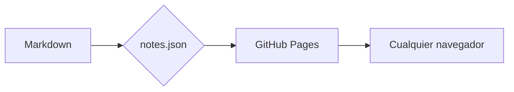

# Bienvenida

Este sitio convierte archivos `.md` en páginas con un estilo parecido a **Obsidian** / **HackMD**. Todo lo que ves acá está escrito en Markdown plano dentro de la carpeta `notes/`.

> [!tip] Cómo agregar apuntes
> Poné un `.md` en `notes/` (podés usar subcarpetas), hacé `git push` y en un minuto está publicado. El menú de la izquierda se arma solo.

## LaTeX

Inline: la identidad de Euler es $e^{i\pi} + 1 = 0$ y la suma de Gauss es $\sum_{k=1}^{n} k = \frac{n(n+1)}{2}$.

En bloque:

$$
\int_{-\infty}^{\infty} e^{-x^2}\,dx = \sqrt{\pi}
$$

$$
\binom{n}{k} = \frac{n!}{k!\,(n-k)!}
$$

## Callouts

> [!note] Nota
> Los callouts usan la sintaxis de Obsidian: `> [!tipo] Título`.

> [!warning] Ojo
> Hay de varios tipos: `note`, `info`, `tip`, `warning`, `danger`, `example`, `quote`, `question`…

> [!example]- Plegable (empieza cerrado)
> Con `-` después del tipo queda colapsado, con `+` abierto.

> [!question] ¿Y los links entre notas?
> Funcionan los `[[wikilinks]]`: por ejemplo [[Lógica proposicional]] o [[Lógica proposicional|con otro texto]].

## Código

```python
def fib(n: int) -> int:
    a, b = 0, 1
    for _ in range(n):
        a, b = b, a + b
    return a

print([fib(i) for i in range(10)])
```

```java
@RestController
@RequestMapping("/api/materias")
public class MateriaController {
    @GetMapping("/{id}")
    public Materia get(@PathVariable Long id) {
        return service.buscar(id);
    }
}
```

## Diagramas (Mermaid)



## Tablas y listas

| Concepto | Símbolo | Ejemplo |
|----------|:-------:|---------|
| Conjunción | $\land$ | $p \land q$ |
| Disyunción | $\lor$ | $p \lor q$ |
| Negación | $\lnot$ | $\lnot p$ |

- [x] Publicar el sitio
- [ ] Pasar los apuntes de la facu
- [ ] Estudiar

1. Primer paso
2. Segundo paso
   - Sub-ítem
   - Otro sub-ítem

Texto con ==resaltado==, **negrita**, *cursiva*, ~~tachado~~ y atajos como <kbd>Ctrl</kbd> + <kbd>K</kbd> para buscar.

---

Para borrar esta nota, eliminá `notes/bienvenida.md` y volvé a generar el manifest.
